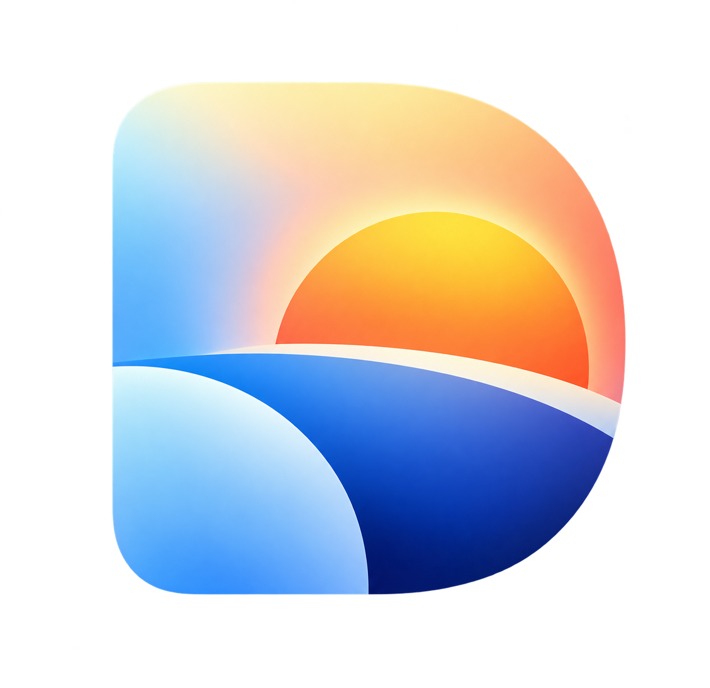

<div align="center">
  
  <h1>Daymark</h1>
  <p><strong>A quieter, more personal place to begin browsing.</strong></p>
  <p>Build your own browser homepage from small, useful widgets. Arrange it around your day, keep it on your device, and skip the build pipeline.</p>
  <p>
    
    
    
  </p>
</div>

---

## A homepage that feels like yours

Daymark is a lightweight, customizable start page made with browser-native HTML, CSS, JavaScript modules, and Web Components. There are no packages to install and no account to create.

Use the left icon rail to show or hide widgets, drag a widget by its grip to rearrange the page, and open **Settings** to choose a theme or widget density. Your layout and widget data are saved in this browser.

## Widgets

| Widget | What it does |
| --- | --- |
| Search | Search with Google, Bing, DuckDuckGo, Brave, Ecosia, Yahoo, ChatGPT, or Perplexity. The selected engine is saved in this browser. |
| News | Read top stories from Google News or configure any HTTPS RSS/Atom feed, with thumbnails when the feed provides them. |
| Clock | Local time and date, optional seconds, and a stopwatch. |
| Weather | Local weather in Fahrenheit, using browser location and Open-Meteo. After you grant location access once, the saved location loads automatically on future visits. |
| Shortcuts | Save, color, and remove links; site favicons are shown when available. |
| Quick note | Keep a persistent plain-text note. |
| To-do list | Add tasks, mark them complete, and clear finished items. |
| Calculator | Evaluate basic arithmetic and parentheses without `eval`. |
| Google Calendar | Paste its Calendar ID, an embed URL, or copied iframe code. The widget builds the embed URL for you. |
| Local launchpad | Save links to websites, local files, or supported app URLs. |

## Personalize

- **Backgrounds:** Choose a theme color independently from the background photo. Photos can be switched off, selected from the searchable Wikimedia Commons gallery, or changed daily using a search term.
- **Five widget densities:** Ultra-dense, Tiny, Dense, Compact, and Standard. Standard is the largest.
- **Widget visibility:** Toggle individual widgets from the left icon rail.
- **Widget layout:** Arrange widgets on a 12-column grid by dragging any widget border. Existing widget sizes are preserved, overlaps are allowed, grid cells have equal horizontal and vertical steps on wide screens, positions are saved per screen, and arrow keys on the focusable top border move a widget one cell at a time. Narrow screens keep a stacked layout.
- **Screens:** Add and switch between screens with separate widget positions and visibility. New screens start with the default widget positions; widget data and appearance settings are shared across screens.
- **Local persistence:** Notes, links, tasks, widget visibility and grid positions, clock options, calendar embed, theme, and size stay in this browser.
- **News feed:** The selected RSS/Atom URL is saved locally and refreshes when Daymark loads.
- **Photo gallery:** Live searches use Wikimedia Commons; selected backgrounds load from Wikimedia's image CDN. Daily photos use the first 50 matching results and rotate by date.

## Run locally

Serve the project directory over localhost. No dependencies or build commands are needed.

```powershell
python -m http.server 8000
```

Then open [http://localhost:8000](http://localhost:8000). Stop the server with <kbd>Ctrl</kbd> + <kbd>C</kbd>.

To use Daymark as your browser homepage, host it over HTTPS or keep it available from a local server, then set that URL in your browser's homepage settings. Replacing the browser's New Tab page requires a browser-specific extension and is not included.

## Browser notes

- Weather asks for location only when you first select **Get local weather**. The coordinates are saved in this browser and the forecast loads automatically on later visits. Geolocation requires HTTPS or localhost. The forecast is provided by [Open-Meteo](https://open-meteo.com/).
- Google Calendar accepts a Calendar ID from **Settings for my calendars** → your calendar → **Integrate calendar**; Daymark builds the embed URL. Private calendars may require viewers to be signed in. Only make a calendar public if its events are safe for anyone to see.
- Browsers may restrict opening `file://` paths or app-specific URLs from the launchpad. Behavior depends on browser and operating system.
- ChatGPT search opens an external ChatGPT page with the query in the URL.
- The News widget retrieves feeds through [RSS2JSON](https://rss2json.com/) to work around browser CORS restrictions. This public service receives the feed URL; unauthenticated requests may be rate-limited by the provider.

## Project map

```text
.
|-- index.html
|-- public/
|   `-- logo.png
`-- src/
    |-- main.js
    |-- storage.js
    |-- styles.css
    `-- components/
        |-- widget-element.js
        |-- clock-widget.js
        |-- search-widget.js
        |-- weather-widget.js
        |-- links-widget.js
        |-- notes-widget.js
        |-- task-list-widget.js
        |-- calculator-widget.js
        |-- calendar-widget.js
        |-- launchpad-widget.js
        `-- news-feed-widget.js
```

## Privacy

Daymark has no backend, analytics, or user accounts. Widget settings and content are stored in `localStorage` for the current browser. External requests happen only when a widget needs them, such as loading weather after a location request, opening a ChatGPT search, loading a site favicon (with Google used as a fallback), or displaying an embedded calendar.